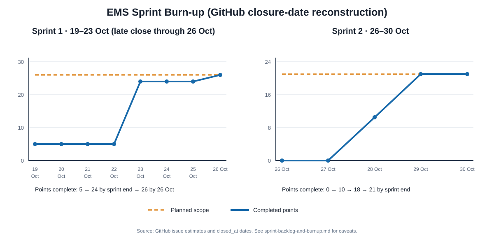

# Sprint backlogs and burn-up evidence

**Source baseline:** GitHub issues #3–#14 and their closed timestamps on `main` at `7f9792c`  
**Sprint dates:** Sprint 1, 19–23 October 2026; Sprint 2, 26–30 October 2026  
**Source rule:** Story points and ownership below come from the GitHub issue descriptions and the Sprint 2 Team Work Plan. Completion dates use each GitHub issue's `closed_at` timestamp.

## Sprint 1 backlog — 19 to 23 October 2026

| Issue | Work item | Assigned members | Estimate (points) | Closed | Delivery evidence |
|---|---|---|---:|---|---|
| [#3](https://github.com/SE-Miniproject-EMS/SE_Miniproject/issues/3) | Event Management backend APIs | GGO4411, ChiragBasanth | 5 | 13 Oct 2026 (before sprint window) | [PR #1](https://github.com/SE-Miniproject-EMS/SE_Miniproject/pull/1), [PR #15](https://github.com/SE-Miniproject-EMS/SE_Miniproject/pull/15), [PR #17](https://github.com/SE-Miniproject-EMS/SE_Miniproject/pull/17) |
| [#4](https://github.com/SE-Miniproject-EMS/SE_Miniproject/issues/4) | Event creation and draft workflow | GGO4411, ChiragBasanth | 3 | 23 Oct 2026 | [PR #1](https://github.com/SE-Miniproject-EMS/SE_Miniproject/pull/1), [PR #15](https://github.com/SE-Miniproject-EMS/SE_Miniproject/pull/15) |
| [#5](https://github.com/SE-Miniproject-EMS/SE_Miniproject/issues/5) | Event validation | dshivasaivarun-lgtm, GGO4411 | 3 | 23 Oct 2026 | [PR #15](https://github.com/SE-Miniproject-EMS/SE_Miniproject/pull/15), [PR #16](https://github.com/SE-Miniproject-EMS/SE_Miniproject/pull/16) |
| [#6](https://github.com/SE-Miniproject-EMS/SE_Miniproject/issues/6) | Event ownership | GGO4411, ChiragBasanth | 2 | 26 Oct 2026 (after sprint window) | [PR #1](https://github.com/SE-Miniproject-EMS/SE_Miniproject/pull/1), [PR #15](https://github.com/SE-Miniproject-EMS/SE_Miniproject/pull/15) |
| [#7](https://github.com/SE-Miniproject-EMS/SE_Miniproject/issues/7) | Authentication and role-based access | dshivasaivarun-lgtm, minestevealex-ux | 5 | 23 Oct 2026 | [PR #18](https://github.com/SE-Miniproject-EMS/SE_Miniproject/pull/18), [PR #19](https://github.com/SE-Miniproject-EMS/SE_Miniproject/pull/19) |
| [#8](https://github.com/SE-Miniproject-EMS/SE_Miniproject/issues/8) | Event Management API tests | GGO4411, minestevealex-ux | 5* | 23 Oct 2026 | [PR #15](https://github.com/SE-Miniproject-EMS/SE_Miniproject/pull/15), [PR #17](https://github.com/SE-Miniproject-EMS/SE_Miniproject/pull/17) |
| [#10](https://github.com/SE-Miniproject-EMS/SE_Miniproject/issues/10) | Frontend form validation | dshivasaivarun-lgtm | 3 | 23 Oct 2026 | [PR #16](https://github.com/SE-Miniproject-EMS/SE_Miniproject/pull/16) |

**Planned estimate:** 21 confirmed points plus the 5-point suggested estimate for Issue #8 = **26 points using the issue's suggested estimate**.

**Result:** Issue #3 was already closed before the official Sprint 1 start; 24/26 points were closed by 23 October; Issue #6 closed on 26 October. All seven backlog items were closed by 26 October. The chart deliberately shows the actual GitHub close dates instead of moving Issue #3 into the sprint window or hiding the late close of Issue #6.

* Issue #8 says “Suggested Estimate: 5 story points”, not a separately confirmed final estimate. It is included as 5 for the reconstructed chart and is called out here so the total is not presented as a formally approved velocity.

## Sprint 2 backlog — 26 to 30 October 2026

| Issue | Work item | Assigned members | Estimate (points) | Closed | Delivery evidence |
|---|---|---|---:|---|---|
| [#9](https://github.com/SE-Miniproject-EMS/SE_Miniproject/issues/9) | API integration testing | GGO4411, minestevealex-ux | 5 | 28 Oct 2026 | [PR #15](https://github.com/SE-Miniproject-EMS/SE_Miniproject/pull/15), [PR #21](https://github.com/SE-Miniproject-EMS/SE_Miniproject/pull/21) |
| [#11](https://github.com/SE-Miniproject-EMS/SE_Miniproject/issues/11) | GitHub Actions CI | ChiragBasanth | 5 | 28 Oct 2026 | [PR #2](https://github.com/SE-Miniproject-EMS/SE_Miniproject/pull/2) |
| [#12](https://github.com/SE-Miniproject-EMS/SE_Miniproject/issues/12) | Regression and end-to-end testing | dshivasaivarun-lgtm | 5 | 29 Oct 2026 | [PR #24](https://github.com/SE-Miniproject-EMS/SE_Miniproject/pull/24), [PR #45](https://github.com/SE-Miniproject-EMS/SE_Miniproject/pull/45) |
| [#13](https://github.com/SE-Miniproject-EMS/SE_Miniproject/issues/13) | Project documentation | minestevealex-ux | 3 | 29 Oct 2026 | [PR #40](https://github.com/SE-Miniproject-EMS/SE_Miniproject/pull/40) |
| [#14](https://github.com/SE-Miniproject-EMS/SE_Miniproject/issues/14) | Final demo and release | dshivasaivarun-lgtm, ChiragBasanth | 3 | 30 Oct 2026 | [PR #41](https://github.com/SE-Miniproject-EMS/SE_Miniproject/pull/41), [PR #45](https://github.com/SE-Miniproject-EMS/SE_Miniproject/pull/45) |

**Planned estimate:** 21 points. **Result:** all five items, 21/21 points, closed by the Sprint 2 end date (30 October 2026).

## Burn-up chart

The chart is reconstructed from GitHub issue estimates and issue closure timestamps. Sprint 1 starts with 5 points already closed because Issue #3 predates the formal sprint; Issue #6 closes after the planned Sprint 1 end. Sprint 2 reaches all 21 planned points by 30 October.

## Data and interpretation

- Daily data is in [`sprint-burnup-data.csv`](sprint-burnup-data.csv).
- This is a **GitHub closure-based historical reconstruction**, not a native Jira/GitHub Projects burn-up export. The repository does not contain a daily Jira worklog or scope-change history, so no unrecorded in-progress transitions are fabricated.
- The course deliverable specified exactly two sprints: Sprint 1 (19–23 Oct 2026) and Sprint 2 (26–30 Oct 2026), followed by a development-cycle freeze. Later feature/NFR issues (#22–#35) are tracked as product/verification backlog, not silently added to Sprint 1 or Sprint 2.
- To replace this reconstructed chart with the official project-board burn-up, export the Jira/GitHub Project sprint history (scope and completed points by day) and commit the export with its generation date.
